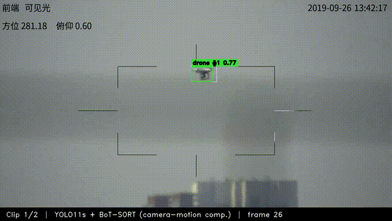

# Airspace Object Detection: detect everything in the air

A detector for objects in the sky that knows six classes (airplane, bird, helicopter, kite, parachute, drone), and flags anything else as **UNKNOWN** instead of forcing it into a wrong class. It also tracks drones across real video.

Full 1-minute demo: [`media/airspace_demo.mp4`](media/airspace_demo.mp4)

## Why

A sky-watching system has two jobs: recognise the things it was trained on, and not lie about the things it wasn't. Most benchmark detectors only measure the first. This project measures both, and also checks how a model trained on one dataset holds up on footage it has never seen.

## Results at a glance

| Question | Result |
|---|---|
| How well does one model handle two datasets? | mAP50-95 **0.760** on MBAOD and **0.670** on AOD4, close to each single-dataset specialist (0.771 / 0.680) |
| Does a benchmark score carry over to new footage? | No. A model trained only on MBAOD scored 0.771 on its own test set but **0.467** on AOD4; drones fell to **0.284**. Training on both datasets raised drones on AOD4 to **0.623** |
| Can it flag objects it was never taught? | At the default threshold the UNKNOWN flag catches **32%** of balloons, rockets and missiles, with false flags on only **0.2 to 0.4%** of normal images. A lower threshold catches **48%** at 3 to 5% false flags |
| Does tracking help on real drone video? | Partly. On 20 Anti-UAV300 videos the detector alone gets precision 0.90 / recall 0.97. BoT-SORT with camera-motion compensation cuts false boxes by ~13% but costs some recall (0.89), and still splits a drone into ~7 track IDs per video |

## How it works

1. **Known-class detector.** YOLO11s, fine-tuned at 640 px on AOD4 (Roboflow, v6) and MBAOD (Roboflow, v1), with both datasets' labels mapped to one 6-class list.
2. **Unknown-object flag.** YOLO-World (`yolov8x-worldv2`) runs alongside, prompted with the six known classes plus 17 other things that fly (balloon, blimp, rocket, missile, paraglider, ...). A YOLO-World box is flagged UNKNOWN when its guess is not one of the six known classes and no known detection explains it. A confident non-known guess also overrides an overlapping known label.
3. **Tracking.** Ultralytics BoT-SORT with sparse optical-flow camera-motion compensation, longer track memory, and a hybrid filter: a box is shown at once if confidence is at least 0.5, otherwise only after its track has lasted 5 frames.

## Experiments (notebooks)

| Step | Notebook | What it tests |
|---|---|---|
| 1 | `notebooks/airspace_week1_baseline.ipynb` | YOLO11s on AOD4 alone (mAP50 0.968, mAP50-95 0.680) |
| 2 | `notebooks/airspace_mbaod_cross_dataset.ipynb` | Train on MBAOD, test on MBAOD and on AOD4 (the generalization gap) |
| 3 | `notebooks/airspace_combined_model.ipynb` | One model trained on both datasets (the main model) |
| 4 | `notebooks/airspace_unknown_flag.ipynb` | YOLO-World UNKNOWN flag: false-flag rate vs. catch rate |
| 5 | `notebooks/airspace_tracking.ipynb` | Detector vs. ByteTrack vs. BoT-SORT on Anti-UAV300 video |
| 6 | `notebooks/airspace_demo_video.ipynb` | Builds the demo video and GIF |

All notebooks ran on Kaggle (GPU T4 x2). To rerun them, add your own Roboflow API key as a Kaggle secret named `ROBOFLOW_API_KEY`; no key is stored in this repo.

## What I learned

- **Benchmark scores hide the real gap.** The single-dataset model looked excellent on its own test set and fell apart on a different camera setup. More varied training data fixed most of it.
- **Data plumbing bugs look like model bugs.** One run silently trained on the wrong labels because Ultralytics resolves symlinked image folders back to the original labels. Relabelled data has to be copied or edited in place.
- **An open-vocabulary model needs strict rules to be useful.** The first version of the UNKNOWN flag fired on 9 to 13% of normal images. Restricting it to non-known guesses cut that to 0.2%.
- **Tracking is not free.** On a panning camera, plain ByteTrack dropped recall from 0.97 to 0.75. Camera-motion compensation and a hybrid confirmation rule recovered most of that, but a strong detector was already doing most of the work.

## Limitations and next steps

- About 1 in 6 never-seen objects is still given a wrong known label (balloons are most often called "parachute" or "kite").
- Track IDs fragment on fast camera pans; a re-identification step or a drone-specific motion model would help.
- Small, far-away drones are the weakest case. Training at 1280 px is the next experiment.
- Datasets planned but not yet used: DUT Anti-UAV, Drone-vs-Bird.

## Data and credits

- AOD4 and MBAOD from Roboflow Universe, used under their dataset licences.
- Anti-UAV300 (visible-light test videos) via Kaggle.
- Open Images (validation split) for unknown-object and demo photos.
- Ultralytics YOLO11 and YOLO-World.
